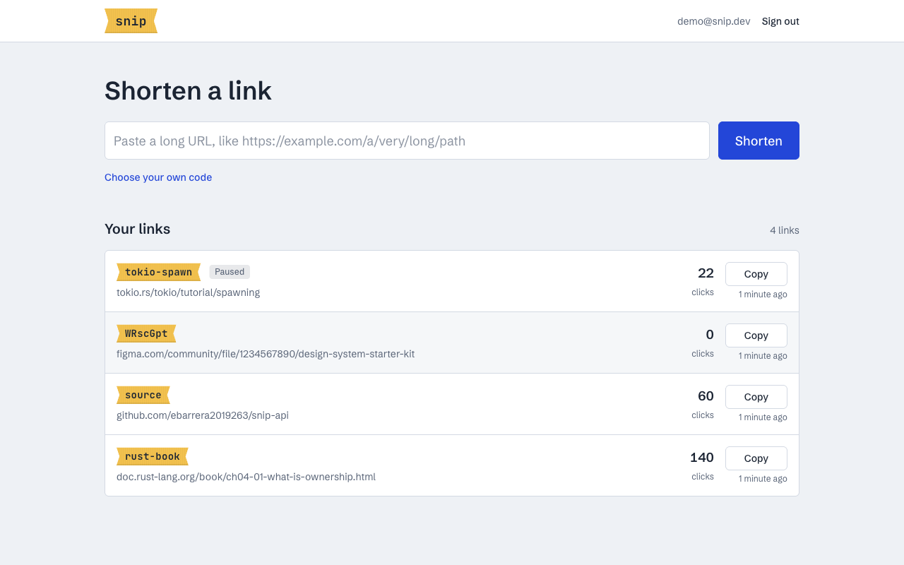
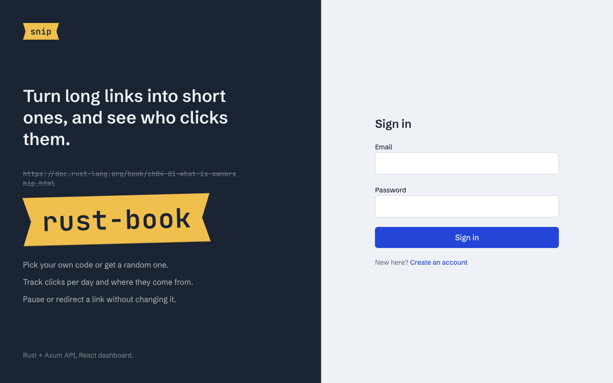

# snip

A full-stack URL shortener: a **Rust + Axum** REST API with a **React + TypeScript** dashboard. Users sign up, create short links (random or custom codes, optionally expiring), and get click analytics per link.


<p align="center">
  
  
</p>

## Dashboard (`web/`)

- **React 19 + TypeScript + Vite**, styled with **Tailwind CSS v4**
- **TanStack Query** for server state: caching, pagination and cache updates after mutations
- **React Router** for the links list and the per-link analytics page
- A typed API client that mirrors the Rust response types, with automatic sign-out when a token expires
- A hand-built 30-day click chart with an accessible text summary (no chart library)
- Responsive down to mobile, with keyboard focus styles and reduced-motion support

## API features

- **JWT authentication**: register and log in. Passwords are hashed with **Argon2id** on a blocking thread so they don't stall the async runtime.
- **Short links**: random 7-character codes or custom ones (`/rust-book`), optional expiry date, and enable/disable without deleting.
- **Redirects**: `GET /{code}` returns `307` to the target and records the click (timestamp, referrer, user agent) in a transaction.
- **Analytics**: total clicks, clicks per day over the last 30 days, and the top referrers.
- **Ownership isolation**: users only see their own links. Other users' links return `404`, so you can't tell they exist.
- **Validation**: only `http(s)` URLs are accepted (no `javascript:`), short codes are restricted, and routes like `docs` are reserved. Errors come back as consistent JSON.
- **Interactive API docs**: an OpenAPI 3.1 spec generated from the code, served with Scalar at `/docs`.
- **Production touches**: structured logging (`tracing`), graceful shutdown on SIGTERM, migrations on startup, a multi-stage Docker image running as a non-root user, and CI (fmt, clippy, tests, docker build).

## Tech stack

| Concern        | Crate                                  |
| -------------- | -------------------------------------- |
| HTTP framework | `axum` 0.8 + `tokio`                   |
| Database       | `sqlx` with SQLite (migrations)        |
| Auth           | `jsonwebtoken`, `argon2`               |
| Validation     | `validator`, `url`                     |
| API docs       | `utoipa` + `utoipa-scalar`             |
| Observability  | `tracing`, `tower-http` (trace, CORS)  |

## Getting started

```bash
cp .env.example .env          # then set JWT_SECRET (openssl rand -hex 32)
cargo run
```

Then open **http://localhost:8080/docs** to explore and try the API.

In another terminal, start the dashboard (Node 20+):

```bash
cd web
npm install
npm run dev
```

Open **http://localhost:5173**. In development, Vite proxies `/api` to the Rust server on port 8080.

### With Docker

The image builds both the API and the dashboard, and serves everything from one port:

```bash
docker build -t snip .
docker run -p 8080:8080 -v snip-data:/data \
  -e JWT_SECRET=$(openssl rand -hex 32) snip
```

Open http://localhost:8080 for the dashboard and http://localhost:8080/docs for the API docs.

### Deploying to Railway

The repo includes `railway.json` (Dockerfile build + `/health` check).

1. New project → **Deploy from GitHub repo** → pick this repo.
2. Add a **volume** mounted at `/data` so the SQLite database survives redeploys.
3. Set the variables `JWT_SECRET` (`openssl rand -hex 32`), `BASE_URL` (the public URL, e.g. `https://snip.up.railway.app`) and `RAILWAY_RUN_UID=0` (Railway volumes are owned by root).
4. Under **Networking**, generate a public domain.

## Configuration

| Variable        | Default                  | Description                                   |
| --------------- | ------------------------ | --------------------------------------------- |
| `JWT_SECRET`    | required (≥ 32 chars)    | Key used to sign tokens                       |
| `DATABASE_URL`  | `sqlite://snip.db`       | SQLite file (created if missing)              |
| `BASE_URL`      | `http://localhost:8080`  | Public URL used to build `short_url`          |
| `PORT`          | `8080`                   | Listening port                                |
| `JWT_TTL_HOURS` | `24`                     | Token lifetime                                |
| `STATIC_DIR`    | unset (`/app/web` in Docker) | Serve the built dashboard from this folder |
| `RUST_LOG`      | `snip_api=info,...`      | Log filter                                    |

## API

| Method   | Path                     | Auth | Description                     |
| -------- | ------------------------ | :--: | ------------------------------- |
| `POST`   | `/api/auth/register`     |      | Create an account               |
| `POST`   | `/api/auth/login`        |      | Get a token                     |
| `GET`    | `/api/auth/me`           |  ✔   | Current user                    |
| `POST`   | `/api/links`             |  ✔   | Create a short link             |
| `GET`    | `/api/links?page&per_page` | ✔  | List your links (paginated)     |
| `GET`    | `/api/links/{id}`        |  ✔   | Get a link                      |
| `PATCH`  | `/api/links/{id}`        |  ✔   | Change target / enable / disable |
| `DELETE` | `/api/links/{id}`        |  ✔   | Delete a link                   |
| `GET`    | `/api/links/{id}/stats`  |  ✔   | Click analytics                 |
| `GET`    | `/{code}`                |      | Redirect (`307`, `404`, `410`)  |
| `GET`    | `/health`                |      | Health check (pings the DB)     |
| `GET`    | `/docs`                  |      | Interactive docs                |

### Example

```bash
# Register and keep the token
TOKEN=$(curl -s -X POST localhost:8080/api/auth/register \
  -H 'content-type: application/json' \
  -d '{"email":"ada@example.com","password":"correct-horse"}' | jq -r .token)

# Create a link
curl -s -X POST localhost:8080/api/links \
  -H "authorization: Bearer $TOKEN" -H 'content-type: application/json' \
  -d '{"target_url":"https://doc.rust-lang.org/book/","code":"rust-book"}'

# Follow it
curl -i localhost:8080/rust-book          # 307 → https://doc.rust-lang.org/book/

# See the stats
curl -s localhost:8080/api/links/1/stats -H "authorization: Bearer $TOKEN"
```

```json
{
  "link_id": 1,
  "total_clicks": 1,
  "last_clicked_at": "2026-10-13T20:09:52.766867Z",
  "daily": [{ "date": "2026-10-13", "clicks": 1 }],
  "top_referrers": [{ "referrer": "https://github.com", "clicks": 1 }]
}
```

Errors always have the same shape:

```json
{ "error": { "code": "conflict", "message": "the code 'rust-book' is already taken" } }
```

## Project structure

```
src/
├── main.rs          # Startup: config, logging, DB, graceful shutdown
├── lib.rs           # Router assembly
├── config.rs        # Environment configuration
├── db.rs            # Pool + migrations
├── auth.rs          # Argon2 hashing, JWT, `AuthUser` extractor
├── extract.rs       # `ValidatedJson` extractor
├── error.rs         # `AppError` → JSON responses
├── models.rs        # DB rows and request/response types
├── validation.rs    # URL and short-code rules
├── docs.rs          # OpenAPI definition
└── routes/          # Handlers: auth, links, redirect, health
migrations/          # SQL schema
tests/api.rs         # End-to-end tests against an in-memory DB
web/                 # React dashboard
├── src/lib/         # Typed API client, auth context, formatting helpers
├── src/pages/       # Sign in, links list, link analytics
└── src/components/  # Layout and shared UI
```

## Testing

```bash
cargo test
```

The integration tests build the real router on an in-memory SQLite database and send HTTP requests through it. They cover auth, validation, the link CRUD, pagination, ownership isolation, redirects, analytics, and expired/disabled links.

## Possible next steps

- Rate limiting on redirects and auth endpoints
- Swap SQLite for PostgreSQL (SQLx makes this mostly a driver change)
- QR code generation per link
- Refresh tokens
