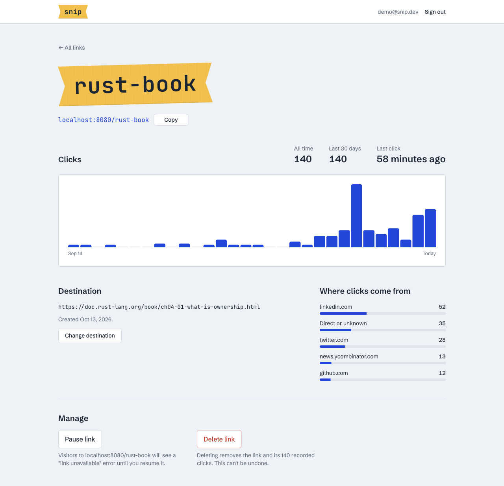

# snip dashboard

React dashboard for [snip-api](../README.md): sign in, create short links, and see click analytics for each one.



## Stack

- **React 19 + TypeScript**, built with **Vite**
- **Tailwind CSS v4** for styling
- **TanStack Query** for server state (caching, pagination, refreshing data after changes)
- **React Router** for navigation

## Running it

The dashboard needs the API running on port 8080. From the repository root:

```bash
cp .env.example .env   # set JWT_SECRET
cargo run
```

Then, in another terminal:

```bash
cd web
npm install
npm run dev
```

Open http://localhost:5173. Vite proxies `/api` requests to the API, so no CORS setup is needed. To point at an API on another host, set `VITE_API_PROXY`:

```bash
VITE_API_PROXY=http://localhost:9000 npm run dev
```

## Scripts

| Command           | What it does                         |
| ----------------- | ------------------------------------ |
| `npm run dev`     | Start the dev server on port 5173    |
| `npm run build`   | Type-check and build into `dist/`    |
| `npm run lint`    | Lint with oxlint                     |
| `npm run preview` | Serve the production build locally   |

## Structure

```
src/
├── main.tsx             # Providers: React Query, router, auth
├── App.tsx              # Routes: signed-out vs signed-in
├── index.css            # Theme tokens and the "label tape" style for short codes
├── lib/
│   ├── api.ts           # Typed API client and error type
│   ├── auth.tsx         # Auth provider (token storage, sign in/out)
│   ├── useAuth.ts       # Auth context and hook
│   └── format.ts        # Date, URL and plural helpers
├── components/
│   ├── Layout.tsx       # Header and page shell
│   └── ui.tsx           # Tape, CopyButton, LinkStatus, ErrorText
└── pages/
    ├── AuthPage.tsx     # Sign in / create account
    ├── LinksPage.tsx    # Shorten form and links list
    └── LinkPage.tsx     # Analytics, destination, pause and delete
```

## Design notes

- Short codes are styled as printed label-maker tape: the one bold visual element. Everything else stays quiet.
- Schibsted Grotesk for the interface; JetBrains Mono only for codes and URLs.
- The 30-day click chart is plain HTML/CSS with an accessible text summary instead of a chart library.
- The token is kept in `localStorage`, which is simple for a demo. A production app would use an `HttpOnly` cookie.
